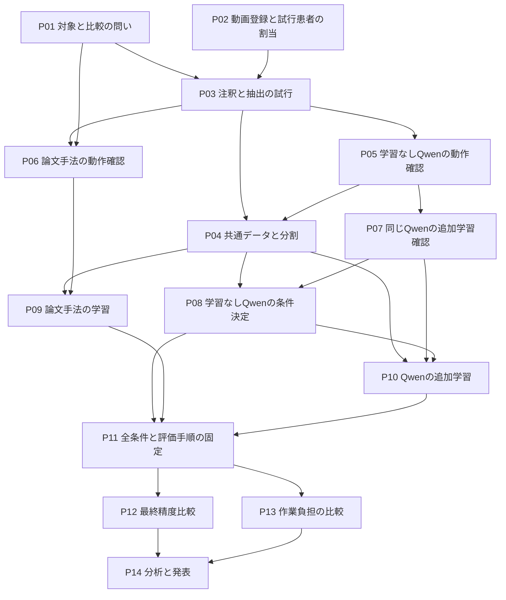

# 最終比較までの研究計画

更新日：2026年11月2日。方針版：v1.9。
本人が指定した到達点は、学習なしQwen、論文手法、追加学習ありQwenの最終比較を終えること。
手作業M0との確認修正時間の比較も、既存の研究目的として含める。
今回の目的は、固定ROI内に成人の手や腕が映る区間の指定を支援し、確認修正後に必要な品質を満たす条件で、手作業の負担をどこまで減らせるか評価すること。[D013](方針変更履歴.md)
主対象はROI内の可視の手や腕とし、詳細な境界規則、日付、患者数、採用モデル、品質の許容値は未確定。
本注釈へ進む前に、P02、P03、P05をつないで短い連続範囲の注釈、少数推論、区間化、確認修正を一周する。

## 作業を区切る単位

研究を14の工程に分け、各工程に成果物と完了条件を置く。
進捗の正本は[research_state.json](research_state.json)の`work_packages`とする。
既存のstep01からstep04は保存場所として保ち、過去の実行IDや実行時コードを移動しない。

| 工程 | 取り組むこと | 保存場所 | 完了を示す成果物 |
|---|---|---|---|
| P01 | 検出対象と比較の問いを具体化 | step01 | 対象の定義案、比較表、原論文から確認すべき条件 |
| P02 | 動画と患者を登録し、試行患者を割り当てる | step02 | ローカルの動画一覧、患者対応、開発利用履歴 |
| P03 | 少数の注釈と画像抽出を試す | step02 | 試行ラベル、境界の判断例、抽出対応表、実作業時間 |
| P04 | 共通データと患者分割を作る | step02 | 版付きの分割、規則、共通ラベル、入力一覧、検査結果 |
| P05 | 学習なしQwenと区間化の動作を確認する | step03/M1 | 時刻付き少数推論、区間候補、元動画での確認修正、時間とメモリ |
| P06 | 論文手法を実装して動作確認する | step03/M3 | 原論文との対応表、IRへの変更一覧、少数の学習と予測 |
| P07 | 同じQwenを追加学習できるか確認する | step03/M2 | 勾配更新、保存、再読込、推論の記録 |
| P08 | 学習なしQwenの比較用条件を決める | step03/M1 | 調整用の保存予測、採用する質問と推論条件 |
| P09 | 論文手法を共通データで学習する | step03/M3 | 学習済み重み、調整結果、採用する設定 |
| P10 | Qwenを共通データで追加学習する | step03/M2 | 追加学習済み重み、調整結果、M1との条件照合 |
| P11 | 全手法の条件と評価手順を固定する | step01とstep04 | 記入済み固定票、採点の検査結果、時間比較の手順 |
| P12 | 共通の最終評価患者で精度を比較する | step03とstep04 | 全手法の保存予測、患者別の指標、失敗の集計 |
| P13 | 手作業と確認修正の負担を比較する | step02とstep04 | 操作時間、処理時間、修正後品質、初期費用の比較 |
| P14 | 誤りを分析し、結論と発表へまとめる | step04 | 比較表、誤り事例、限界、根拠と対応する説明 |

P05からP07は、手法の実行経路が成立するかを確かめる工程とする。
P08からP10では共通の研究データを使い、調整患者で条件を選ぶ。
いずれも最終評価の成績とは区別する。

## 依存関係と進める順番

P01の文献確認とP02のデータ確認は並行して進められる。
P04の本データ作成を待つ間に、割当済みの試行患者でP05からP07を進める。
P06はQwenの実装完了を待たずに着手できる。
同じGPUを使う重い処理は同時実行を前提にせず、待ち時間を文書化や注釈に充てる。

M1とM2の主比較モデルは、P05の推論とP07の追加学習が同じ基盤モデルで成立してから決める。
主比較モデルを変更した場合、P08の予測も同じ基盤モデルで作り直す。

## P01からP04の完了条件

**P01**では、映り込み、接触、臨床的介入を区別し、何を検出したいかを文章と判定例で示す。
2021年の基準論文は本人確認済みだが、本文に基づく構造や学習条件の確認は残っている。
論文に書かれている条件、確認できない条件、IRへの適用で変える条件を別欄にする。

**P02**では、利用許可、患者数、動画数、保存先、長さを確認する。
患者単位で試行に使う対象を先に割り当て、その後にフレームを抽出する。
試行や質問調整で見た患者を、後から手つかずの最終評価患者へ戻さない。
患者対応と実パスはGit対象外で保持する。

**P03**では、保存再開、ROI、区間境界、未注釈、判定不能、時間計測を実動画で試す。
ROIは撮影環境ごとの固定設定を同じ環境の動画で共有し、各動画で基準画像と位置を照合する。環境が変わったら適用範囲とROIを分ける。[D012](方針変更履歴.md)
環境別保存と動画対応の実装確認、ROI内の手や腕の境界規則、モデルへの適用方式は試行で確認する。
ツールのJSONから共通ラベルへの変換と、ラベルから抽出画像への対応を保存コードで確認する。
現在のツールは想定枚数を表示できるが、実際の画像抽出と共通CSVへの変換は未実装である。
1fpsは初期の試行条件とし、短い映り込みの見逃しを確認してから本実験への採用を決める。
協力者がいる場合は一部を独立注釈し、不一致を整理する。
協力者がいない場合は再注釈の範囲を先に決め、独立した正解確認が不足する制約を残す。

**P04**では、患者単位の学習、調整、最終評価の分割をフレーム抽出と拡張より先に固定する。
本注釈へ進む前にP05の区間化と元動画での確認修正までの試行結果を確認し、対象の定義、抽出と時刻の対応、必要な作業量を見直す。患者の用途割当と分割準備は先行してよい。
試行患者の用途を保ち、ラベル規則と抽出条件を版付きで確定してから本データを生成する。
M2とM3で学習対象を共有し、M1からM3で評価対象を共有する。
最終評価用の正解は予測を見ずに作成し、モデル開発から分離する。
必要患者数や最終評価の分割が成立しない場合は、患者単位の交差検証などを再設計してから本比較に進む。
評価方法が決まる前に、便宜的なフレーム分割で先へ進まない。

## 手法ごとの小さな完了条件

| 工程 | 実行する単位 | 次へ渡す条件 |
|---|---|---|
| P05 | 環境情報を保存、候補を読み込む、連続範囲の少数推論、時刻付き出力から区間化、元動画で確認修正 | 入出力、失敗、区間候補、修正内容、処理と操作の時間、最大メモリを追跡できる |
| P06 | 原論文の条件を表にする、IR入力を実装、少数バッチで更新、保存再読込、予測保存 | モデルとラベルの対応が正しく、原論文との差が説明できる |
| P07 | M1と同じ基盤版を読み込む、少数の学習対象で更新、重みを保存、新しいプロセスで再読込 | 画像と正解が学習へ渡り、更新対象と重みの変化を確認できる |
| P08 | 調整用患者で質問候補と失敗を確認、質問を選ぶ、設定を保存、基準予測を残す | M2にも同じ質問と推論設定を渡せる |
| P09 | 共通の学習データで訓練、調整患者で条件と重みを選ぶ、保存予測を残す | 学習履歴、停止規則、採用重み、全調整対象の結果がそろう |
| P10 | 共通の学習データで追加学習、調整患者で重みを選ぶ、M1と同条件で推論 | M1との違いと追加学習の影響を検討できる記録がそろう |

詳細の入口は[M1](step03_各手法の実装と実験/M1_学習なしQwen/README.md)、[M3](step03_各手法の実装と実験/M3_論文手法/README.md)、[M2](step03_各手法の実装と実験/M2_追加学習Qwen/README.md)に分ける。
P05からP07の小規模な暗記や損失低下を、未知患者への精度の証拠にしない。
11月2日に、P05の時刻付き少数推論を区間候補へ変換して元動画で確認修正する[試行](step03_各手法の実装と実験/M1_学習なしQwen/P05_少数推論動作確認/README.md#少数推論から区間化までの試行)を本人が採用した。結合条件などの設定値は未決であり、まだ実装も実行もしていない。
各方式の調整回数、計算時間、作業時間も保存し、調整に使った資源の違いを示す。

P08で質問を決めた後は、P10でM2だけ別の質問へ変えない。
共通質問の見直しが必要ならP08へ戻り、M1とM2を両方測り直す。
方式固有の前処理は記録し、M1とM2は入力、解像度、推論条件もそろえる。
M3のIRへの変更が大きい場合は「論文に基づくIR分類器」と説明し、完全再現とは呼ばない。

## P11からP14で比較を成立させる条件

**P11**では、[評価条件固定票](step01_文献調査と実験設計/評価条件固定票.md)に主指標、患者別集計、失敗の扱い、区間化、学習と調整の予算、重み、入力版を記入する。
採点コードは小さな既知の区間例で確認する。
時間比較の対象割当と順序も、この段階で決める。
最終評価対象のラベルと開発環境の分離、全手法の出力数の照合を確認してから進む。

**P12**では、固定した条件で全手法の最終予測を保存し、同じ患者と入力を使って採点する。
M2対M1で追加学習の効果、M3対M1とM3対M2で分類法との差を調べる。
フレーム指標に加え、連続区間に残る介入と余計に除外した非介入を集計する。
患者ごとの差、分母、判定不能、形式違反、処理失敗を含めて示す。
最終結果を見た条件変更は新たな開発として記録し、同じ評価を手つかずの成績として再利用しない。

**P13**では、M0の手作業と、M1からM3の出力を確認修正する作業を比較する。
必要な完成品質を満たす条件で作業時間を比べる。品質条件を満たさない方法も記録し、短い作業時間だけで有用性を判断しない。
既存の正解作成時間を、そのまま未視聴動画への作業時間とみなさない。
同じ動画を直後に繰り返す影響を避け、可能なら作業者と対象セットの割当を入れ替える。
一人だけなら未視聴の別セットと順序を事前に決め、対象差と慣れを制約として報告する。
実作業時間、計算の経過時間、初期の注釈と学習費用を分け、修正後の品質も確認する。
M0の正解ラベル自身を使ってM0の分類精度を算出しない。

**P14**では、成功例と失敗例、患者差、原論文との差、作業削減が成立した条件を整理する。
精度の高さだけで人の負担が減ったと結論しない。
3手法の最終結果とM0との作業比較がそろい、各結論を実行IDへ対応付けられた状態を研究計画の完了とする。

## 作業量と日程の決め方

締切と持ち時間は未確認なので、過去の12月3日向け配分を確定日程として使わない。
まずP03で動画1分当たりの注釈と再確認の時間を測り、P05からP07で読込、推論、1更新当たりの時間とメモリを測る。
実測値から本注釈、本学習、最終推論、確認修正の必要量を見積もり、締切と照合する。
GPUを共用する処理は直列の所要時間として計上する。
失敗修正の余裕は、試行で分かった失敗内容に基づいて別枠で確保する。

直近の作業は、次の3つの成果物に絞る。

1. P02：利用できる動画と患者を確認し、試行に使う患者を割り当てる。
2. P01：原論文の入力、構造、初期重み、学習と評価条件、IRへの変更を1枚の対応表にする。
3. P03：割当済みの少数動画で、注釈、保存再開、共通形式への変換、画像とラベルの対応、作業時間を確認する。

GPUの環境情報は実データを待たずに確認できる。
動画を確保できない間は文献と環境を進め、性能測定や注釈完了とは扱わない。

## 失敗や遅延が起きたとき

| 状況 | 対応 | 完了とみなさないもの |
|---|---|---|
| データが見つからない | P01と環境確認を進め、P02の確認事項を残す | 実データの準備、性能比較 |
| Qwenの追加学習が成立しない | 失敗原因と版を記録し、同じ基盤で推論と学習が成立する候補を再検討する | M2の精度評価 |
| 論文の条件が分からない | 未記載と取得失敗を分け、採用する変更点を明示する | 原著の完全再現 |
| 患者数が不足する | 調整と評価の独立性を保つ分割案を作り直す | フレーム数だけで補った未知患者評価 |
| 予定期間に収まらない | モデルサイズ違い、動画入力、追加のデータ量比較などを先に延期する | M2やM3を黙って省いた主要比較の完了 |
| 記録の互換性がない | 元の完了済み記録を保持し、新規実行の固定形式と照合経路を整える | 記録検査だけによるモデル動作確認 |

取得時の記録不整合は、旧形式の`20261102_video_ui_02`に関する固定項目検査だった。
11月2日に旧形式の個別登録を追加し、原本をpartialとして保持する処理と、新規実行の固定形式検査を分けた。
モデル実行ランナーによる自動記録は引き続き未統合である。
今回の細分化は管理工程の変更で、ラベル定義、分割、評価基準の確定や実験の実施を意味しない。

## 工程の作業場所と発表への接続

本人の11月2日の説明に基づき、各工程の作業フォルダ内にコード、設定、実行記録を置く運用に統一する。
各P工程にREADME、scripts、configs、runsを用意し、状態JSONに保存先を登録した。
新規実行は工程内のrunsに保存し、旧実行は元の場所に保つ。
フォルダだけの準備を、実装、実験、注釈、検証の完了とみなさない。
発表は[根拠対応表](スライド/発表根拠の対応表.md)から実行と成果物へさかのぼれるようにする。
詳しい記録とデータの保存範囲は[共通運用](共通/作業フォルダと発表根拠の運用.md)に定める。
